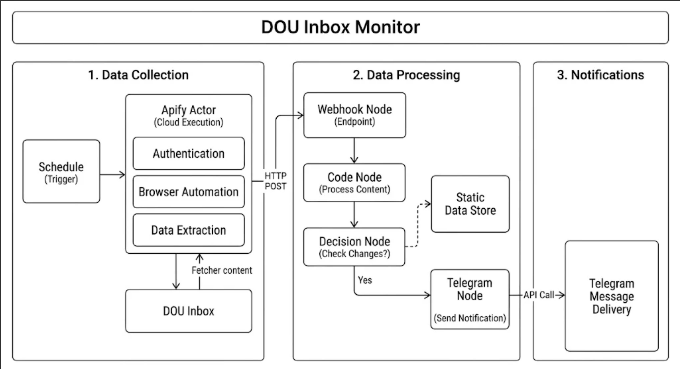
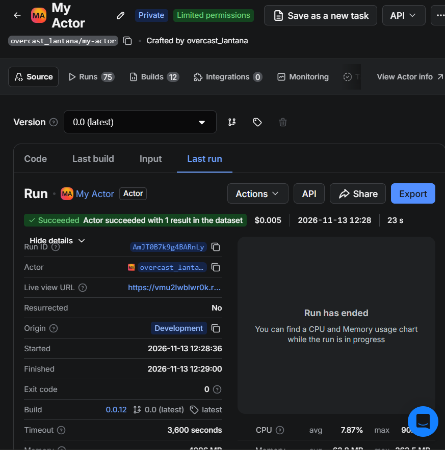
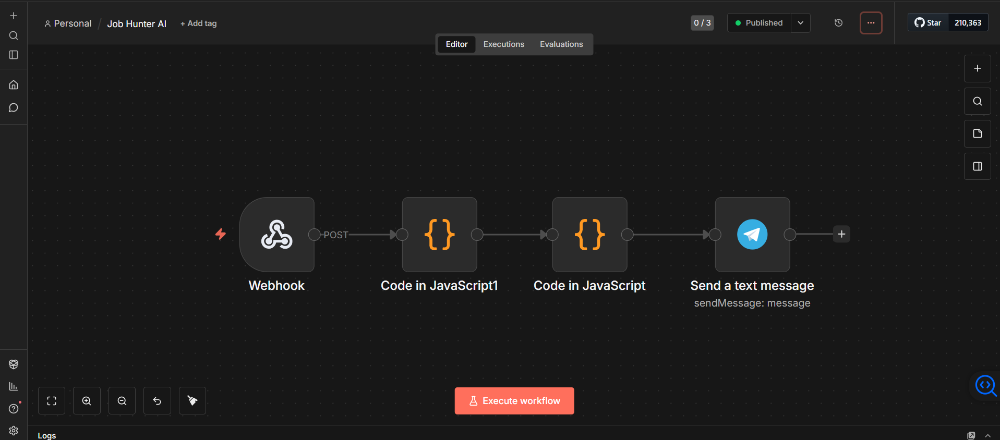
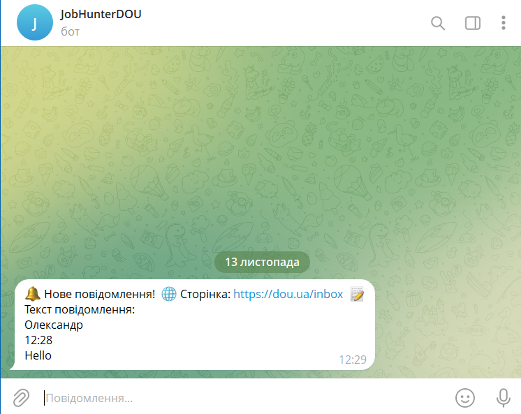

# DOU Inbox Monitor

An automated monitoring system that tracks changes in the DOU Inbox and sends Telegram notifications when new inbox content is detected.

The project combines **Apify, Playwright, n8n, and Telegram Bot API** to automate inbox monitoring without manually checking the DOU website.

## Overview

DOU Inbox Monitor periodically accesses the DOU Inbox using an authenticated browser session, extracts page content, and sends it to an n8n workflow.

The workflow processes the received data, checks whether the inbox content has changed, and sends a Telegram notification when a change is detected.

## Features

- **Automated monitoring** — periodically checks the DOU Inbox.
- **Browser automation** — uses Playwright to access the website.
- **Authenticated access** — uses session cookies to access the private inbox.
- **Data extraction** — collects inbox page content.
- **Change detection** — compares the latest content with previously processed data.
- **Duplicate prevention** — avoids sending repeated notifications when the content has not changed.
- **Telegram notifications** — delivers updates directly to a Telegram chat.
- **Cloud execution** — the Apify Actor can run on Apify infrastructure.

## Tech Stack

| Technology | Purpose |
|---|---|
| JavaScript | Main programming language |
| Node.js | Runtime environment |
| Apify | Cloud execution and Actor management |
| Playwright | Browser automation |
| n8n | Workflow automation and data processing |
| Telegram Bot API | Sending notifications |
| ngrok | Exposing the local n8n webhook to the internet |

## Architecture

The system consists of three main parts:

1. **Apify Actor** — opens DOU Inbox, uses authentication cookies, extracts page content, and sends the result to an n8n webhook.
2. **n8n Workflow** — receives the data, processes it, and checks whether the content has changed.
3. **Telegram Bot** — sends a notification when new or changed content is detected.

### Diagram

### 1. Apify Actor

The Apify Actor runs in the cloud, accesses the DOU Inbox, extracts page content, and sends the collected data to the n8n webhook.

### 2. n8n Workflow

The n8n workflow receives data from Apify, processes the inbox content, checks for changes, and triggers Telegram notifications.

### 3. Telegram Notification

When a change is detected, the Telegram bot sends a notification containing the available inbox information.

## Project Structure

dou-inbox-monitor/
│
├── apify-actor/
│   ├── src/
│   │   ├── main.js
│   │   └── routes.js
│   │
│   ├── .actor/
│   │   └── input_schema.json
│   │
│   ├── package.json
│   └── Dockerfile
│
├── n8n/
│   └── workflow.json
│
├── screenshots/
│   ├── apify-actor.png
│   ├── n8n-workflow.png
│   └── telegram-notification.png
│
└── README.md

## How It Works

### 1. Apify Actor — Data Collection

The Apify Actor is responsible for accessing the DOU website and retrieving inbox content.

It uses:

- **Playwright** to launch and control a browser.
- **Session cookies** to authenticate the user.
- **JavaScript** to extract the page content.
- **HTTP POST requests** to send the collected data to the n8n webhook.

The Actor receives its configuration through Apify Actor Input.

The cookies are provided as a secret input parameter, allowing the Actor to access the authenticated DOU session.

### 2. n8n — Data Processing

The n8n workflow receives the data through a Webhook node.

The workflow contains the following steps:

1. **Webhook** — receives the data sent by Apify.
2. **Code Node** — extracts the relevant inbox content.
3. **Code Node** — compares the current content with the previously stored content.
4. **Telegram Node** — sends a notification if a change is detected.

The workflow uses n8n static data to store the previously processed content.

If the content has not changed, the workflow stops without sending a notification.

### 3. Telegram — Notifications

Telegram Bot API is used to deliver notifications directly to the user's chat.

A notification includes:

- A notification title.
- A link to the DOU Inbox.
- The extracted inbox content.

This allows the user to receive updates without manually opening the DOU website.

## Setup and Configuration

### Prerequisites

Before setting up the project, make sure you have:

- An Apify account.
- An n8n instance.
- A Telegram bot created through BotFather.
- A Telegram chat ID.
- An authenticated DOU account.
- ngrok (if using locally hosted n8n).

### 1. Configure the Apify Actor

1. Create a new JavaScript Actor in Apify.
2. Copy the files from the `apify-actor` directory into the Actor.
3. Configure the Actor Input schema.
4. Obtain the authenticated DOU session cookies from your browser.
5. Provide the cookies through the Actor Input as a JSON array.
6. Configure the n8n webhook URL in the Actor.
7. Run the Actor and verify that it successfully retrieves the inbox content.

**Important:** Never commit actual session cookies to GitHub.

### 2. Configure n8n

1. Open your n8n instance.
2. Import `n8n/workflow.json`.
3. Configure the Telegram credentials.
4. Set your Telegram chat ID.
5. Configure the Webhook node.
6. Activate the workflow.

If n8n is running locally, use ngrok to expose the webhook endpoint to Apify.

Use the production webhook URL after activating the workflow.

### 3. Configure Telegram

1. Create a bot using [BotFather](https://t.me/BotFather).
2. Copy the bot token.
3. Add Telegram credentials in n8n.
4. Configure the destination chat ID.
5. Test the workflow by sending sample data.

### 4. Schedule Automatic Monitoring

Use Apify Schedules to run the Actor periodically.

For example, you can configure the Actor to execute every 15 minutes.

This allows the system to monitor the inbox automatically without manually starting each run.

## Security

This project uses authentication cookies to access private DOU Inbox content.

For security reasons:

- Never publish actual DOU cookies.
- Never commit Telegram bot tokens.
- Keep API credentials in Apify secrets or n8n credentials.
- Do not expose private webhook URLs unnecessarily.
- Use environment variables or secret input fields for sensitive configuration.

The repository contains only the code and configuration templates required to understand and reproduce the project.

## Limitations

- The DOU session cookies must remain valid.
- Expired cookies may require re-authentication.
- If n8n is hosted locally, the computer and ngrok tunnel must remain available for webhook delivery.
- Monitoring frequency depends on the configured Apify Schedule.
- The current implementation detects changes in the extracted inbox content; it does not guarantee complete parsing of every individual message.

## Future Improvements

- Move n8n to a cloud-hosted environment.
- Add monitoring logs and execution status tracking.
